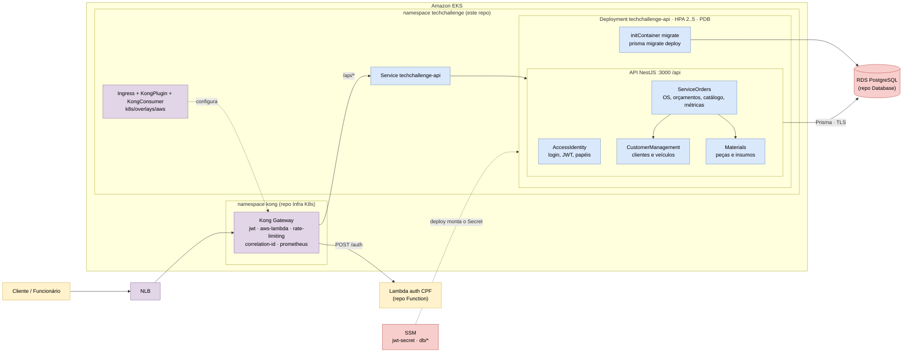
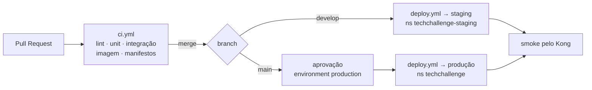

# Tech Challenge - Sistema de Oficina Mecânica

**Aplicação principal executando em Kubernetes**: API NestJS modular, banco PostgreSQL com
Prisma, autenticação JWT, documentação Swagger, testes automatizados, manifestos Kustomize
(com as rotas e plugins do **Kong**, o API Gateway) e CI/CD com deploy no **Amazon EKS**
(homologação e produção).

> Documentação arquitetural geral (diagrama de componentes, sequências, RFCs, ADRs e modelo
> de dados): **[tech-challenge-docs](https://github.com/Jean-Carlo-Torres/tech-challenge-docs)**.

## Sumário

- [Propósito](#propósito)
- [Estrutura multi-repositório](#estrutura-multi-repositório)
- [Tecnologias utilizadas](#tecnologias-utilizadas)
- [Arquitetura deste repositório](#arquitetura-deste-repositório)
- [ADRs e RFCs](#adrs-e-rfcs)
- [Estrutura principal](#estrutura-principal)
- [Como executar localmente](#como-executar-localmente)
- [Deploy (Kubernetes e AWS)](#deploy-kubernetes-e-aws)
- [CI/CD](#cicd)
- [APIs: Swagger e links dos deploys](#apis-swagger-e-links-dos-deploys)
- [Autenticação](#autenticação)
- [Testes e qualidade](#testes-e-qualidade)

## Propósito

O sistema atende uma oficina mecânica de médio porte que precisa sair de controles manuais
e centralizar:

- cadastro de clientes e veículos;
- abertura e acompanhamento de ordens de serviço;
- catálogo de serviços de mão de obra;
- controle de peças e estoque;
- aprovação de orçamentos;
- histórico e métricas operacionais.

Este repositório entrega a **aplicação** e tudo o que roda dentro do cluster: código da API,
`Dockerfile`, manifestos Kustomize (Deployment, Service, HPA, PDB, NetworkPolicy, RBAC) e a
configuração do Kong (Ingress, KongPlugin, KongConsumer). Também é o **dono do schema** do
banco (migrations do Prisma).

A modelagem foi alinhada com as notas do Obsidian em `Pessoal/Pós Graduação/Fase 1 - Tech Challenge`, principalmente os documentos de desafio, DDD, linguagem ubíqua e arquitetura do MVP.

## Estrutura multi-repositório

O projeto está organizado em quatro repositórios independentes, cada um com o próprio CI/CD
e deploy automático para a nuvem, mais um repositório de documentação:

| # | Repositório | Responsabilidade |
|---|---|---|
| 1 | [TechChallange---Function-Serverless](https://github.com/DevKaue/TechChallange---Function-Serverless) | Function Serverless (Lambda) de autenticação do cliente por CPF |
| 2 | [TechChallenge---Infraestrutura-Kubernetes-com-Terraform](https://github.com/DevKaue/TechChallenge---Infraestrutura-Kubernetes-com-Terraform) | VPC, EKS, addons, ALB Controller, Kong, ECR, IAM/OIDC (Terraform) |
| 3 | [tech-challenge-database-infra](https://github.com/DevKaue/tech-challenge-database-infra) | Banco gerenciado RDS PostgreSQL (Terraform) |
| **4** | **tech-challenge-app- (este)** | **Aplicação principal em Kubernetes** (API, manifestos, rotas do Kong, deploy homolog/prod) |
| — | [tech-challenge-docs](https://github.com/Jean-Carlo-Torres/tech-challenge-docs) | Documentação arquitetural geral |

Regras de proteção aplicadas em todos os repositórios:

- branch `main`/`master` protegida — sem commits diretos;
- merge somente via **Pull Request**, com o CI verde;
- deploy automático das branches de **homologação** (`develop`) e **produção** (`main`).

## Tecnologias utilizadas

| Camada | Tecnologia | Justificativa |
|---|---|---|
| Linguagem | TypeScript (Node.js 22) | Tipagem estática reduz bugs e é amplamente adotada no ecossistema Node.js. |
| Framework back-end | NestJS | Arquitetura modular nativa, suporte a DDD, injeção de dependência e decorators. |
| Banco de dados | PostgreSQL 15 (Amazon RDS na nuvem) | Relacional robusto, ideal para OS, clientes, peças, estoque e históricos. |
| ORM | Prisma | Migrations versionadas (aplicadas por initContainer no deploy) e client type-safe. |
| Autenticação | JWT (HS256) + Passport.js | Padrão de mercado; mesmo segredo validado pelo Kong e emitido também pela Lambda de CPF. |
| Documentação API | Swagger (`@nestjs/swagger`) | Geração automática a partir de decorators e DTOs do NestJS. |
| Testes | Jest + Supertest | Testes unitários, de integração (Postgres real) e e2e. |
| Carga | k6 | Teste de estresse para observar o HPA (`k6/stress-test.js`). |
| Containerização | Docker (multi-stage) + Docker Compose | Imagem de produção enxuta; Compose para desenvolvimento local. |
| Orquestração | Kubernetes (Amazon EKS) + Kustomize | Overlays `local` (Docker Desktop) e `aws` (EKS). |
| API Gateway | Kong Ingress Controller (DB-less) | Roteamento, validação de JWT, rate limit, correlation-id e métricas Prometheus. |
| Registro de imagens | Amazon ECR | Tag imutável por commit. |
| Segredos | AWS SSM Parameter Store | O deploy monta o Secret do app (banco e JWT) a partir do SSM. |
| Observabilidade | CloudWatch Container Insights + plugin `prometheus` do Kong | Métricas/logs de pods e latência/status por rota. |
| CI/CD | GitHub Actions | CI em PR; deploy em `develop` (staging) e `main` (produção). |
| Segurança / scan | SonarQube | SAST, cobertura, vulnerabilidades e code smells em um único painel. |

## Arquitetura deste repositório

O MVP segue um **monólito modular**: um único deploy, com módulos que refletem os bounded
contexts do domínio (Clean Architecture + DDD tático por módulo). No cluster, a API fica
atrás do Kong, que valida o JWT antes de encaminhar.



Fluxo principal da OS:

```text
RECEIVED -> IN_DIAGNOSIS -> WAITING_APPROVAL -> IN_EXECUTION -> FINISHED -> DELIVERED -> CLOSED
```

Diagramas detalhados em [`docs/diagrams`](docs/diagrams) (Mermaid):

| Diagrama | Conteúdo |
|---|---|
| [01-arquitetura-geral.mmd](docs/diagrams/01-arquitetura-geral.mmd) | Módulos NestJS e integrações entre contextos |
| [02-modelo-dados.mmd](docs/diagrams/02-modelo-dados.mmd) | Modelo de dados (ER) |
| [03-maquina-estados.mmd](docs/diagrams/03-maquina-estados.mmd) | Máquina de estados da OS |
| [04-camadas-modulo.mmd](docs/diagrams/04-camadas-modulo.mmd) | Camadas de um módulo (Clean Architecture) |
| [05-bounded-contexts.mmd](docs/diagrams/05-bounded-contexts.mmd) | Bounded contexts |
| [06-fluxo-completo-os.mmd](docs/diagrams/06-fluxo-completo-os.mmd) | Fluxo completo da OS |
| [07-fluxo-deploy.mmd](docs/diagrams/07-fluxo-deploy.mmd) | Fluxo de deploy: CI, push no ECR e rollout no EKS |
| [08-api-gateway-kong.mmd](docs/diagrams/08-api-gateway-kong.mmd) | Componentes do API Gateway (Kong) |
| [09-sequencia-autenticacao-os.mmd](docs/diagrams/09-sequencia-autenticacao-os.mmd) | Sequência: autenticação e abertura de OS |

Diagramas C4 (Contexto, Container e Componentes): [docs/C4Model/README.md](docs/C4Model/README.md).

## ADRs e RFCs

ADRs em [docs/ADRs](docs/ADRs):

- [ADR-001 — Monólito modular com bounded contexts](docs/ADRs/ADR-001-monolito-modular-bounded-contexts.md)
- [ADR-002 — Clean Architecture + DDD tático por módulo](docs/ADRs/ADR-002-clean-architecture-ddd-tatico-por-modulo.md)
- [ADR-003 — Node.js + TypeScript + Nest](docs/ADRs/ADR-003-nodejs-typescript-nest.md)
- [ADR-004 — PostgreSQL como banco principal](docs/ADRs/ADR-004-postgresql-como-banco-principal.md)
- [ADR-005 — Kong como API Gateway](docs/ADRs/ADR-005-kong-como-api-gateway.md)

RFCs em [docs/RFCs](docs/RFCs):

- [RFC-001 — Estratégia de autenticação (Lambda emite, Kong valida, aplicação revalida)](docs/RFCs/RFC-001-estrategia-de-autenticacao.md)

> As ADRs 001 a 004 foram inseridas na Fase 2. As decisões transversais da Fase 3 (nuvem,
> banco, autenticação, padrão de comunicação, HPA) estão consolidadas no
> [tech-challenge-docs](https://github.com/Jean-Carlo-Torres/tech-challenge-docs).

## Estrutura principal

```text
.
├── prisma/                  # schema, migrations e seed do Prisma
├── src/
│   ├── access-identity/     # identidade de acesso, JWT + Passport, token de cliente
│   ├── customer-management/ # clientes e veículos
│   ├── materials/           # peças e estoque
│   ├── service-orders/      # ordens de serviço (inclui catalog/)
│   └── common/              # infraestrutura compartilhada, validadores, Prisma
├── test/                    # testes de integração e e2e
├── k6/                      # teste de carga (HPA)
├── k8s/
│   ├── base/                # Deployment, Service, HPA, PDB, NetworkPolicy, RBAC
│   └── overlays/
│       ├── local/           # Docker Desktop + Postgres em StatefulSet
│       └── aws/             # EKS: Ingress e plugins do Kong, KongConsumers
├── .github/workflows/       # ci.yml e deploy.yml (homolog + produção)
├── Dockerfile               # multi-stage: development e production
├── docker-compose.yml       # API, PostgreSQL e perfil opcional do SonarQube
└── sonar-project.properties # configuração do scan SonarQube
```

> A infraestrutura AWS (VPC, EKS, Kong, RDS, ECR) **não** fica aqui — vive nos
> repositórios de infraestrutura (itens 2 e 3), com o Terraform e o ciclo de vida deles.

## Como executar localmente

### Opção 1 — Docker Compose (API + Banco)

Pré-requisito: Docker.

```bash
cp .env.example .env          # Windows: copy .env.example .env
docker compose up --build
```

Sobe a API e o PostgreSQL, executa as migrations e o *seed*. Os valores de exemplo do `.env`
funcionam sem edição (o arquivo é gitignored).

> Esqueceu o `cp`? O Compose aborta com
> `required variable POSTGRES_PASSWORD is missing a value: copie .env.example para .env`.

Swagger: http://localhost:3000/api/docs

### Opção 2 — Kubernetes local (Docker Desktop)

Depois de habilitar o Kubernetes no Docker Desktop:

```bash
cp k8s/overlays/local/.env.secret.example k8s/overlays/local/.env.secret
npm run k8s:build && npm run k8s:apply
npm run k8s:seed
npm run k8s:forward     # http://localhost:8080/api/docs
npm run k8s:status      # pods, svc e hpa
```

### No cluster da AWS (EKS)

O deploy só aplica as migrations; ele não popula o banco. Para os usuários e dados
de demonstração, rode o workflow **Seed (manual)** (Actions → Seed (manual) → Run
workflow) e digite `SEED` em `confirmar`. Ele recusa rodar se já houver ordens de
serviço (a menos que `permitir_com_ordens` esteja marcado), porque o seed apaga
usuários, clientes, veículos, catálogo e peças antes de inserir. Os usuários criados
têm a senha pública `Tech@123`: use só em ambiente de demonstração.

O cliente sintético do smoke da Lambda de autenticação é criado pelo próprio deploy
(passo "Garantir o cliente de smoke"), se o secret `SMOKE_CPF_ATIVO` existir no
environment, com o mesmo valor do environment da Lambda.

### Opção 3 — Node.js direto

Com um PostgreSQL acessível e o `DATABASE_URL` configurado no `.env`:

```bash
npm ci
npm run prisma:migrate:deploy && npm run prisma:seed
npm run start:dev
```

O passo a passo completo (local ~10 min, AWS ~30 min) está no **[QUICKSTART.md](QUICKSTART.md)**;
contrato de configuração e validação dos manifestos em [k8s/README.md](k8s/README.md).

## Deploy (Kubernetes e AWS)

O alvo de produção é o **Amazon EKS**. A infraestrutura (cluster, Kong, RDS, ECR) é
provisionada pelos repositórios de infraestrutura; este repositório entrega a aplicação.

**Pré-requisitos** (nesta ordem): Infra K8s aplicada → banco aplicado (contrato em
`/techchallenge/<env>/db/*` no SSM) → Lambda publicada.

| Branch | Ambiente | Namespace | Deploy |
|---|---|---|---|
| `develop` | homolog (staging) | `techchallenge-staging` | automático via `deploy.yml` (com `STAGING_ENABLED=true`) |
| `main` | production | `techchallenge` | automático via `deploy.yml`, com aprovação manual no environment `production` |

Configuração do repositório no GitHub (Settings → Secrets and variables → Actions):

| Nome | Tipo | Para quê |
|---|---|---|
| `EKS_CLUSTER_NAME`, `ECR_REPOSITORY`, `AWS_REGION` | variável | Outputs do repositório de Infra K8s (`cluster_name`, `ecr_repository_name`) |
| `STAGING_ENABLED` | variável | `true` para habilitar o deploy de homologação |
| `AWS_DEPLOY_ROLE` | secret | Role do OIDC (fora do AWS Academy) |
| `AWS_LAB_ACCESS_KEY_ID`, `AWS_LAB_SECRET_ACCESS_KEY`, `AWS_LAB_SESSION_TOKEN` | secret | Credenciais temporárias do AWS Academy |
| `PASSWORD_SALT`, `WEBHOOK_SECRET` | secret | Hash de senha e HMAC do webhook de orçamento |

Deploy manual (resumo dos passos do pipeline; o detalhe, incluindo a montagem do
`.env.secret` e das credenciais do Kong a partir do SSM, está no [QUICKSTART.md](QUICKSTART.md)):

```bash
aws eks update-kubeconfig --name techchallenge-prod --region us-east-1
cd k8s/overlays/aws
kustomize edit set image techchallenge-api=<ecr_url>:<tag>
kubectl apply -k .
kubectl -n techchallenge rollout status deploy/techchallenge-api
```

> A AWS custa **~US$ 7/dia** com tudo de pé. O teardown está no QUICKSTART e a ordem
> importa: `kubectl delete -k` **antes** de destruir a infra nos repositórios de
> infraestrutura.

## CI/CD

| Workflow | Dispara em | Jobs / passos |
|---|---|---|
| [`ci.yml`](.github/workflows/ci.yml) | PR e push em `develop`/`main` | **Lint, build e testes unitários** (typecheck, ESLint, Jest com cobertura) · **Testes de integração** (Postgres 15 como service) · **Build da imagem de produção** (só em PR) · **Validação dos manifestos** (kustomize + kubeconform nos overlays) |
| [`deploy.yml`](.github/workflows/deploy.yml) | push em `develop` (staging) e `main` (produção) | Credenciais AWS (OIDC ou lab) → login no ECR → build e push (reaproveita a imagem se o commit já foi publicado) → kubeconfig → monta o Secret do app a partir do SSM → fixa imagem e namespace no overlay → `kubectl diff` → `kubectl apply -k` → aguarda rollout → **rollback automático** em caso de falha → **smoke test** pelo Kong (`/api/health` = 200 e rota protegida sem token = 401) |



## APIs: Swagger e links dos deploys

| Ambiente | Swagger | Base da API |
|---|---|---|
| Local (Docker Compose) | http://localhost:3000/api/docs | http://localhost:3000/api |
| Local (Kubernetes) | http://localhost:8080/api/docs | http://localhost:8080/api |
| AWS (via Kong) | `http://<KONG_URL>/api/docs` | `http://<KONG_URL>/api` |

> **Deploy ativo:** o ambiente AWS (AWS Academy) **não está de pé no momento**, então não
> há URL pública fixa. O endereço é o hostname do NLB do Kong, gerado a cada
> provisionamento:
>
> ```bash
> kubectl -n kong get svc kong-gateway-proxy -o jsonpath='{.status.loadBalancer.ingress[0].hostname}'
> ```
>
> O Swagger fica exposto pelo Kong como rota pública (`SWAGGER_ENABLED=true` no overlay
> `aws`). O contrato do login por CPF (`POST /auth`, atendido pela Lambda) está no
> [OpenAPI](https://github.com/DevKaue/TechChallange---Function-Serverless/blob/main/docs/api/openapi.yaml)
> e na [coleção Postman](https://github.com/DevKaue/TechChallange---Function-Serverless/blob/main/docs/postman/techchallenge-auth.postman_collection.json)
> do repositório da Function.

Rotas no Kong (definidas em `k8s/overlays/aws/`):

| Rota | Proteção | Destino |
|---|---|---|
| `POST /auth` | rate limit 10/min/IP | Lambda de CPF |
| `POST /api/auth/login` | rate limit 10/min/IP | API |
| `GET /api/health`, `GET /api/docs` | pública | API |
| `POST /api/service-orders/estimates/:id/external-status` | pública no gateway, HMAC na API | API |
| demais `/api/*` | plugin `jwt` (token de funcionário ou de cliente) | API |

## Autenticação

**Funcionário** (atendente/mecânico) — login por e-mail e senha:

```text
POST /api/auth/login
```

```json
{
  "email": "ana.santos@oficina.com",
  "password": "Tech@123"
}
```

O endpoint legado `POST /api/auth/login-admin` continua disponível com o mesmo payload.
Depois envie `Authorization: Bearer <TOKEN>`. A identidade autenticada pode ser consultada
em `GET /api/auth/me`.

**Cliente** — autenticação por CPF na Function Serverless, via Kong:

```bash
curl -X POST http://<KONG_URL>/auth -H 'content-type: application/json' -d '{"cpf":"111.444.777-35"}'
```

O token de cliente (`type: customer`) só é aceito nas rotas marcadas com
`@CustomerAccess()` e apenas para as OS do próprio cliente, por exemplo
`GET /api/service-orders/:id`, `GET /api/service-orders/:id/status` e a aprovação do
orçamento. Nas demais rotas, a API responde 403.

## Testes e qualidade

```bash
docker compose exec -it api sh
npm run test:all
npm run test:all:cov
```

Depois abra `coverage/lcov-report/index.html` no navegador. O scan do SonarQube roda com
o perfil opcional do Compose (`scripts/sonar.sh`).
